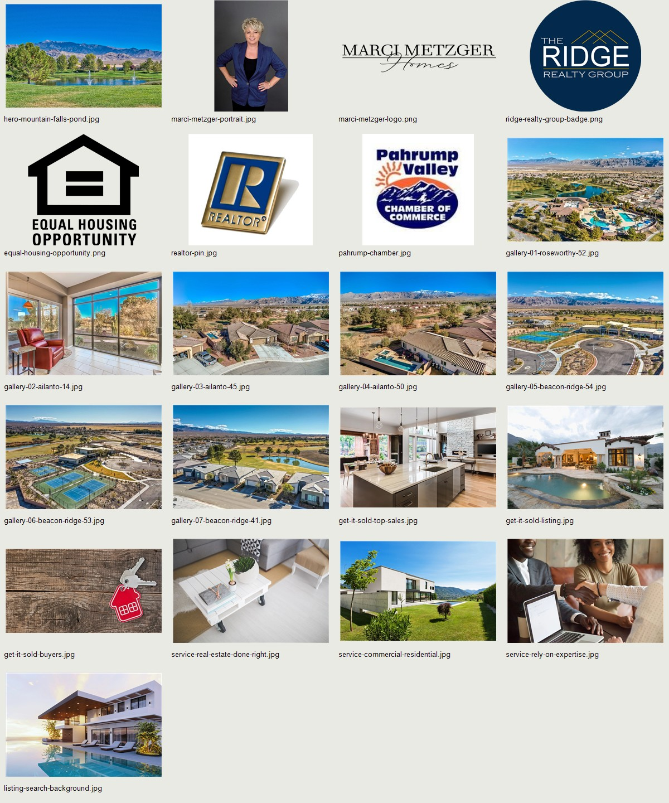

# Marci Metzger — Pahrump Residence

A responsive, single-page homepage redesign for Marci Metzger and The Ridge Realty Group in Pahrump, Nevada.

## Project

- HTML, CSS, and vanilla JavaScript; no package installation or build step.
- Adapted from the free TemplateMo Villa Agency layout, with selected Bootstrap grid rules and custom navy/gold styling.
- All 21 original homepage image assets are downloaded locally, including the complete seven-photo gallery.
- Single-page buying/selling guidance, services, dated 2021 results, phone, address, office hours, and official social links.
- Accessible mobile navigation, native gallery dialog, keyboard controls, and reduced-motion support.
- A dark company footer with real service links and verified business details.

## Photography

This contact sheet shows the actual project assets; it is not a browser screenshot. Full original files and their provenance are in `assets/`. The hero is 2560 × 1700; the seven official gallery originals are 1024px wide. See [IMAGE-QUALITY.md](IMAGE-QUALITY.md).

Browser screenshots can be added under `docs/screenshots/` after visual checks. Automated screenshot capture was unavailable during preparation, so no screenshot-based validation is claimed.

## Deploy on Vercel

1. Open [Vercel](https://vercel.com/new) and import `adam-Dev2002/luxury-presence`.
2. Use **Other** for Framework Preset.
3. Keep **Root Directory** at the repository root (`./`).
4. Enable the Build Command override and leave it empty.
5. Use `.` for Output Directory. No install command or environment variables are required.
6. Deploy and open the production domain in a private browser window to confirm public access.

`vercel.json` contains the static-site settings. This repository already has the selected homepage and all dependencies at its root; do not choose a parent project folder or the earlier design collection.

These settings follow [Vercel's static build documentation](https://vercel.com/docs/builds/configure-a-build).

## Local use

Open `index.html` directly, or serve this directory with a static server. With Node installed, one option is `npx serve .`.

## Contact and search behavior

Search preferences prepare a message for Marci while preserving text the visitor has written. Contact review lets the visitor copy that message and send it through the verified official contact form. A direct official-contact link, Zillow link, and phone links are also available. The page does not claim a message has been sent and does not assume an email recipient.

## Validation

Local file references, image coverage, seven-photo order, internal anchors, source paragraphs, business facts, HTML IDs, CSS balance, and JavaScript syntax were checked. Shared interaction logic passed ten checks using DOM stubs. Rendered desktop/tablet/mobile checks remain required; these logic checks do not replace a browser review.

## Attribution

See [TEMPLATE-SOURCE.md](TEMPLATE-SOURCE.md) for the actual TemplateMo and Bootstrap source reuse, permissions, and hashes. Vendor copyright and license notices are retained. Social icons use Bootstrap Icons under MIT. See [IMPLEMENTATION-NOTE.md](IMPLEMENTATION-NOTE.md) for the design rationale.
